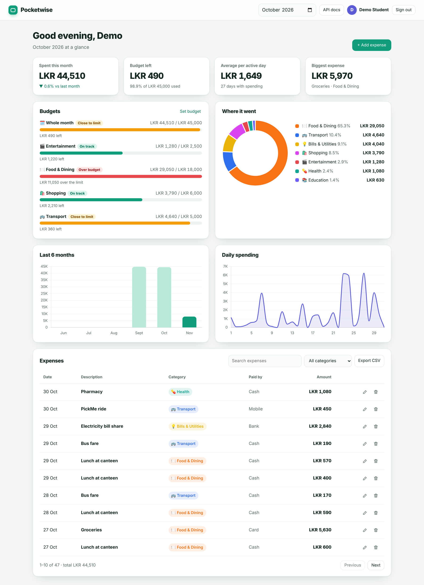
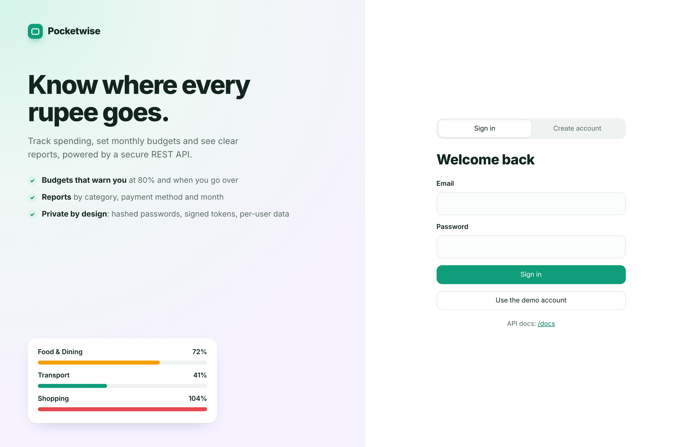
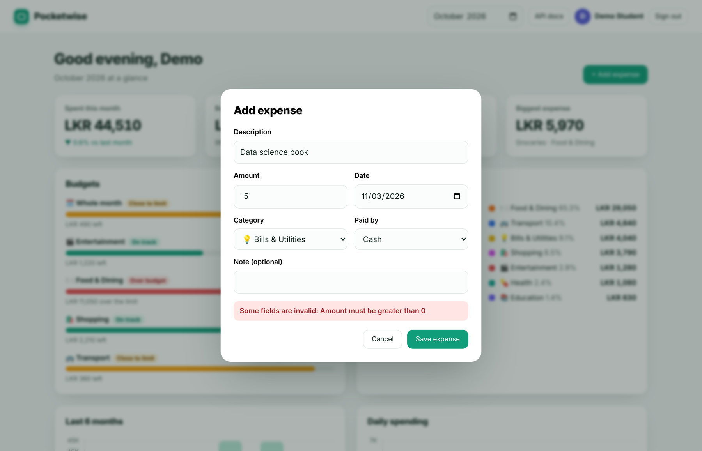
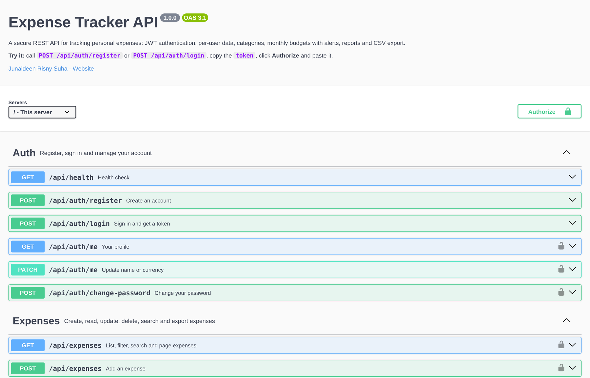

<div align="center">

# 💸 Pocketwise — Expense Tracker API

**A secure, documented and tested REST API for personal expense tracking, with a dashboard that uses it.**

[](https://github.com/DevRisny/Pynexia_Backend_Expense_Tracker_API/actions/workflows/ci.yml)




</div>

---

## ✨ Highlights

| | |
|---|---|
| 🔐 **Real authentication** | Register and sign in with bcrypt-hashed passwords and signed JWTs (HS256, 2-hour expiry, issuer check). Unknown emails and wrong passwords get the same answer in the same time, so attackers cannot find which emails exist. |
| 🧱 **Data isolation** | Every query is scoped to the signed-in user. Tests prove one user cannot read, edit, delete or even file an expense under another user's category. |
| 🎯 **Budgets that warn you** | Monthly limits, overall or per category. Each budget reports spent, remaining, % used, a status (`ok` → `warning` at 80% → `over`) and a **month-end projection** at the current pace. |
| 📊 **Reports** | Totals, share by category, payment-method split, daily trend, top 5 expenses and month-over-month change. |
| 🔎 **Search & filters** | Date range, category, payment method, min/max amount, text search (wildcards escaped), sorting and pagination with totals. |
| 📄 **CSV export** | Same filters as the list, with protection against spreadsheet formula injection. |
| 💰 **Exact money** | Amounts are stored as integer cents, so 0.1 + 0.2 is exactly 0.3. |
| 🛡️ **Hardened** | Helmet security headers and CSP, rate-limited sign-in, strict validation (unknown fields rejected), 20 KB body limit, request IDs, consistent JSON errors, parameterised SQL. |
| 📘 **Documented** | OpenAPI 3.1 spec with interactive Swagger UI at `/docs`. |
| 🐳 **Ready to ship** | Dockerfile (multi-stage, non-root, health check), `.env.example`, GitHub Actions CI on Node 20 and 22 with `npm audit`. |

<table>
<tr>
<td width="50%"><br><sub><b>Sign in / create account</b>, with a one-click demo account.</sub></td>
<td width="50%"><br><sub><b>Validation</b>: the API's field errors are shown in the form.</sub></td>
</tr>
<tr>
<td colspan="2"><br><sub><b>Interactive API docs</b> at <code>/docs</code>: authorise once and try every endpoint.</sub></td>
</tr>
</table>

---

## 🚀 Quick start

```bash
git clone https://github.com/DevRisny/Pynexia_Backend_Expense_Tracker_API.git
cd Pynexia_Backend_Expense_Tracker_API
npm install
cp .env.example .env          # optional: set your own JWT_SECRET
npm run seed                  # demo account with 3 months of data
npm start
```

| Open | What you get |
|---|---|
| http://localhost:3000 | Dashboard (click **Use the demo account**) |
| http://localhost:3000/docs | Swagger UI |
| http://localhost:3000/openapi.json | OpenAPI 3.1 spec |

Demo account: `demo@expense.app` / `Demo2026!`

**With Docker**

```bash
docker build -t pocketwise .
docker run -p 3000:3000 -e JWT_SECRET=$(openssl rand -hex 32) -v pocketwise-data:/data pocketwise
```

## 🧪 Tests

```bash
npm test        # 19 tests, Node's built-in test runner + supertest, fresh in-memory database each suite
```

They cover sign-up/sign-in, duplicate and weak-password rejection, equal responses for wrong password vs unknown email, tampered tokens, rate limiting, password change, full expense CRUD, money precision, validation (impossible dates, future dates, unknown fields), filters/search/sort/pagination, CSV injection, cross-user isolation, category reassignment, budget statuses, reports and platform behaviour (security headers, 404s, bad JSON).

---

## 📚 API reference

All `/api` routes except health, register and login need `Authorization: Bearer <token>`.

| Method | Endpoint | Description |
|---|---|---|
| `GET` | `/api/health` | Health check |
| `POST` | `/api/auth/register` | Create an account (8 default categories are added) |
| `POST` | `/api/auth/login` | Sign in, returns `{ user, token }` |
| `GET` `PATCH` | `/api/auth/me` | Read or update name / currency |
| `POST` | `/api/auth/change-password` | Change password |
| `GET` | `/api/expenses` | List with `from, to, categoryId, paymentMethod, min, max, q, sort, order, page, limit` |
| `POST` | `/api/expenses` | Add an expense |
| `GET` `PATCH` `DELETE` | `/api/expenses/:id` | Read, partly update or delete one expense |
| `GET` | `/api/expenses/export.csv` | Download as CSV (same filters) |
| `GET` `POST` | `/api/categories` | List (with this month's spending) or create |
| `PATCH` `DELETE` | `/api/categories/:id` | Rename / restyle, or delete (`?reassignTo=` moves its expenses) |
| `GET` `PUT` | `/api/budgets` | Budgets for `?month=YYYY-MM` with status and projection, or create/update one |
| `DELETE` | `/api/budgets/:id` | Remove a budget |
| `GET` | `/api/reports/summary` | Totals and breakdowns for `?month=` or `?from=&to=` |
| `GET` | `/api/reports/monthly` | Last `?months=6` with month-over-month change |

**Example**

```bash
TOKEN=$(curl -s -X POST localhost:3000/api/auth/login -H 'Content-Type: application/json' \
  -d '{"email":"demo@expense.app","password":"Demo2026!"}' | node -pe 'JSON.parse(require("fs").readFileSync(0)).token')

curl -s -X POST localhost:3000/api/expenses -H "Authorization: Bearer $TOKEN" -H 'Content-Type: application/json' \
  -d '{"amount": 1250.50, "description": "Bus pass", "categoryId": 2, "paymentMethod": "card"}'
```

```json
{
  "data": {
    "id": 98, "amount": 1250.5, "description": "Bus pass", "spentOn": "2026-11-03", "paymentMethod": "card", "note": null,
    "category": { "id": 2, "name": "Transport", "icon": "🚌", "color": "#2f6feb" },
    "createdAt": "2026-11-03T16:20:11.402Z", "updatedAt": "2026-11-03T16:20:11.402Z"
  }
}
```

Errors always look the same, with every invalid field listed:

```json
{ "error": { "code": "validation_failed", "message": "Some fields are invalid",
  "details": [ { "field": "amount", "message": "Amount must be greater than 0" },
               { "field": "spentOn", "message": "This is not a real calendar date" } ] } }
```

| Status | When |
|---|---|
| `400` | Body is not valid JSON |
| `401` | No token, invalid/expired token, or wrong credentials |
| `404` | Resource does not exist **or belongs to another user** |
| `409` | Duplicate email or category name, or category still in use |
| `422` | Validation failed |
| `429` | Too many sign-in attempts |

---

## 🏗️ Architecture

```
src/
├── server.js            starts the HTTP server, graceful shutdown
├── app.js               createApp(db, config): middleware, routes, docs (testable, no globals)
├── config.js            environment configuration (random JWT secret if unset; required in production)
├── db.js                SQLite schema, indexes, constraints, default categories
├── money.js             cents conversion, amount/date/month validators
├── openapi.js           OpenAPI 3.1 document
├── middleware/
│   ├── auth.js          JWT verification and signing
│   ├── validate.js      zod validation, returns every invalid field
│   └── errors.js        ApiError, JSON error handler, SQLite constraint mapping
└── routes/              auth, expenses, categories, budgets, reports
public/                  dashboard (vanilla JS + Chart.js served locally, no CDN)
scripts/seed.js          demo data
tests/api.test.js        19 integration tests
```

**Database**

```
users ──< categories ──< expenses
  │                        ▲
  └──────< budgets ────────┘ (category_id NULL = whole-month budget)
```

Foreign keys with `ON DELETE CASCADE` for user data and `RESTRICT` for categories that still have expenses, `CHECK` constraints on amounts and payment methods, unique names per user (case-insensitive), and indexes on `(user_id, spent_on)` and `(user_id, category_id)`.

## 🔧 Configuration

| Variable | Default | Purpose |
|---|---|---|
| `PORT` | `3000` | HTTP port |
| `DB_FILE` | `data/expenses.db` | SQLite file |
| `JWT_SECRET` | random per start | Signing secret, **required** when `NODE_ENV=production` |
| `JWT_EXPIRES_IN` | `2h` | Token lifetime |
| `BCRYPT_ROUNDS` | `12` | Password hashing cost |
| `CORS_ORIGIN` | `*` | Allowed origin |
| `LOGIN_RATE_LIMIT` | `10` | Sign-in/registration attempts per 15 minutes per IP |

## 🛠️ Tech stack

Node.js · Express 5 · better-sqlite3 · zod · jsonwebtoken · bcryptjs · helmet · express-rate-limit · swagger-ui-express · Chart.js · node:test · supertest · Docker · GitHub Actions

---

<div align="center">

Built by **Junaideen Risny Suha** for the **Pynexia Backend Development Internship**, Week 2 (Secure Authentication & Third-Party Integration).

[LinkedIn](https://linkedin.com/in/risny-suha-8a6b66423) · [GitHub](https://github.com/DevRisny)

</div>
